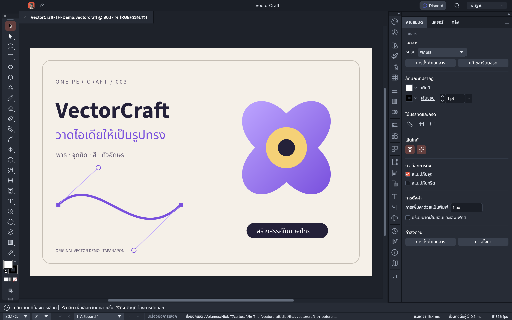
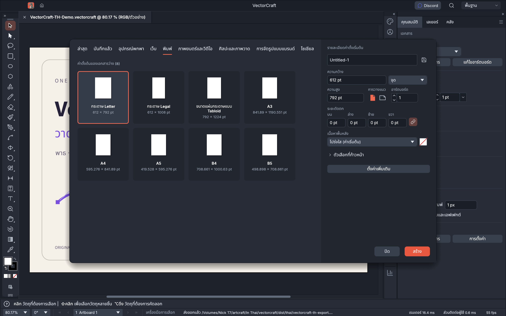

# VectorCraft TH — โปรแกรมวาดภาพเวกเตอร์ภาษาไทย

รุ่นภาษาไทยอิสระของ [VectorCraft โดย storytold](https://github.com/storytold/vectorcraft) สำหรับวาดภาพเวกเตอร์ ออกแบบรูปทรง จัดตัวอักษร และทำงานกับหลายอาร์ตบอร์ด เอนจินและคุณสมบัติหลักเป็นผลงานของผู้พัฒนาต้นฉบับ

[ดาวน์โหลด DMG สำหรับ Mac Apple Silicon](https://github.com/tapanapon-com/vectorcraft-th/releases) · [วันละ Craft / One Per Craft](https://tapanapon.com/one-per-craft) · [README ต้นฉบับ](README-upstream.md)

## ทำอะไรได้บ้าง

- วาดและแก้ไขพาธ จุดยึด เส้นโค้งเบซิเยร์ และรูปทรง
- จัดเลเยอร์ กลุ่มวัตถุ และอาร์ตบอร์ด
- ใช้สีเติม เส้นขอบ การไล่ระดับสี และเครื่องมือรวม/ตัดรูปทรง
- จัดข้อความและฟอนต์ รวมถึงข้อความภาษาไทย
- บันทึกงานแก้ไขต่อเป็น `.vectorcraft` และส่งออก เช่น SVG, PDF หรือ PNG ตามความสามารถของต้นฉบับ
- ใช้ CLI และระบบควบคุมอัตโนมัติที่เรียกเอนจินคำสั่งเดียวกับหน้าจอ

## ภาษาไทยทำงานอย่างไร

หน้าจอ egui/wgpu อ่านคำแปลที่ฝังไว้ใน `crates/ui-egui/src/i18n/th.tsv` จึงใช้เมนูภาษาไทยได้แบบออฟไลน์ เลือก **Preferences › User Interface › Language › ไทย** หรือ **การตั้งค่า › ส่วนติดต่อผู้ใช้ › ภาษา › ไทย** ชื่อไฟล์ เนื้อหาเอกสาร และรหัสคำสั่งคงเดิม

ตารางภาษาไทยมี **7,813 รายการ** ครอบคลุมคีย์จากแค็ตตาล็อกอ้างอิงและการสแกนซอร์สของรุ่นนี้

คำแปลใช้ข้อความร่วมจากโครงการในตระกูล Craft และร่างที่ช่วยแปลด้วยโมเดลภาษาในเครื่อง พร้อมปรับศัพท์และตรวจตัวแปร ตัวเลข และปุ่มลัด ข้อความจากระบบปฏิบัติการ ไลบรารีภายนอก หรือข้อความที่ยังไม่เชื่อมกับระบบแปลอาจเป็นอังกฤษ อ่าน [รายละเอียดภาษาไทย](docs/localization-th.md)

## ติดตั้งบน Mac

1. ดาวน์โหลด DMG จาก [Releases](https://github.com/tapanapon-com/vectorcraft-th/releases)
2. บันทึกงานและปิด VectorCraft เดิม
3. เปิด DMG แล้วลาก **VectorCraft.app** ไปยัง **Applications**
4. เปิดแอปและเลือกภาษาไทยในการตั้งค่า

แพ็กเกจรุ่นนี้สำหรับ **Apple Silicon (arm64)** เซ็นแบบ **ad-hoc และยังไม่ผ่าน Apple notarization** ไม่ใช่รุ่น Intel หรือ Universal ตรวจสอบไฟล์ `.sha256` ที่แนบใน Release ก่อนติดตั้ง หาก macOS แจ้งเตือน ให้ใช้ตัวเลือก Open Anyway ใน Privacy & Security หลังตรวจสอบแหล่งที่มาแล้ว

ต้นฉบับยังเป็น **alpha** โดยเฉพาะการแลกเปลี่ยน `.ai` อาจไม่รักษารายละเอียดครบ รุ่นภาษาไทยไม่ได้เพิ่มความเทียบเท่ากับ Illustrator เก็บไฟล์ต้นฉบับก่อนทดลองใช้งาน อ่าน [ข้อจำกัดต้นฉบับ](docs/gaps.md)

ระบบตรวจอัปเดตชี้ไปที่ `tapanapon-com/vectorcraft-th` เพื่อไม่ให้รุ่นต้นฉบับทับคำแปล ช่องทางตรวจอัปเดตอาจไม่เสนอ prerelease ให้ดาวน์โหลดรุ่นทดลองจาก Releases โดยตรง

## เครดิตและสัญญาอนุญาต

ต่อยอดจาก VectorCraft **0.21.0** ที่ commit [`644acb89cccaad92fd4f1f6af9156ef3f9865e9f`](https://github.com/storytold/vectorcraft/tree/644acb89cccaad92fd4f1f6af9156ef3f9865e9f) เป็นงานแปลอิสระ ไม่ใช่รุ่นทางการหรือได้รับการรับรองจากทีม VectorCraft/ArtCraft

โค้ดและคำแปลใช้ **MIT OR Apache-2.0** คงใบอนุญาตและเครดิตเดิมไว้ ดู [NOTICE](NOTICE), [ASSETS](ASSETS.md) และ [เครดิตฉบับเต็ม](ATTRIBUTION.md) ฟอนต์จาก [craft-fonts](https://github.com/storytold/craft-fonts) รวม Noto Sans Thai ใช้เงื่อนไข OFL และแนบใบอนุญาตในแอป

---

## English — VectorCraft TH, Thai Vector Editor for Mac

VectorCraft TH is an independent Thai localization of [VectorCraft by storytold](https://github.com/storytold/vectorcraft). The upstream contributors created its native Rust vector engine and editing features. This edition adds Thai interface text, locale registration, validation and macOS packaging. It is **not an official or endorsed VectorCraft/ArtCraft release**.

### Features and workflow

Draw Bézier paths and shapes, edit anchors, organize layers and artboards, apply fills, strokes and gradients, and compose text. Save editable `.vectorcraft` documents and export supported formats such as SVG, PDF and PNG. The desktop interface, CLI and automation controls share the same command engine.

The Thai catalog is embedded at build time, so translated menus work offline. Select **Preferences › User Interface › Language › ไทย**. Document contents, filenames and command identifiers retain their original values. The package includes Noto Sans Thai from the official craft-fonts collection with OFL notices.

### Download and installation

[Download the macOS DMG](https://github.com/tapanapon-com/vectorcraft-th/releases). Save your work and quit an existing installation, open the disk image, then drag VectorCraft to Applications. Enable Thai in Preferences.

This prerelease targets **Apple Silicon (arm64)** and is **ad-hoc signed, not Apple-notarized**. It is not an Intel or Universal package. Verify the accompanying SHA-256 checksum. If macOS prompts, use the system's Open Anyway option after checking the source.

### Scope and limitations

The Thai catalog contains **7,813 entries**, covering the reference catalogs and additional source-scanned keys for this revision.

Translation combines shared licensed strings with a locally machine-assisted draft and terminology corrections. Some external diagnostics and text outside the localization system may remain English; catalog coverage is not a guarantee that every possible message is translated. See [localization notes](docs/localization-th.md).

Upstream remains **alpha**, with known file-exchange and `.ai` limitations. This localization does not establish full Illustrator parity. Preserve original documents and read the [upstream gaps](docs/gaps.md).

### Source and credits

Based on upstream **0.21.0**, revision `644acb89cccaad92fd4f1f6af9156ef3f9865e9f`. Code and translation retain **MIT OR Apache-2.0** notices; fonts, assets and branding retain their own terms. See [ATTRIBUTION](ATTRIBUTION.md) and the preserved [upstream README](README-upstream.md).

[One Per Craft — Thai creative apps and updates](https://tapanapon.com/one-per-craft)

Update checks use `tapanapon-com/vectorcraft-th`, keeping upstream-only binaries out of this edition’s update channel. Prereleases may not be offered automatically; download them from Releases.
